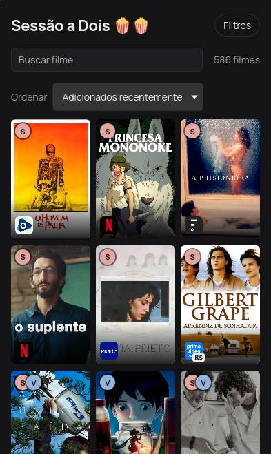
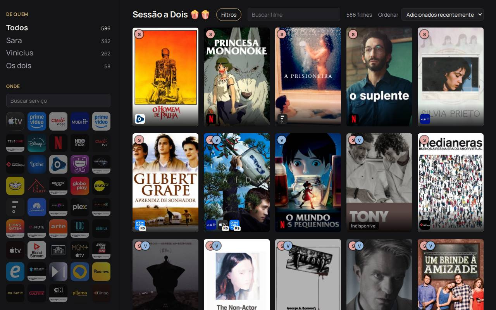

# Sessão a dois

**[viniciusvasconceloss.github.io/sessao-a-dois](https://viniciusvasconceloss.github.io/sessao-a-dois/)**

[Português](#português) · [English](#english)

  
  

## Português

Eu e minha namorada temos cada um uma watchlist no Letterboxd. O app junta as duas numa lista só e mostra onde cada filme pode ser visto no Brasil, pra gente decidir rápido o que assistir.

Foi feito pensando no iPhone (Safari), mas funciona em qualquer navegador, no celular, tablet ou computador.

- **Lista combinada**: filtra por filmes que estão na lista de um, do outro ou dos dois.
- **Onde assistir**: serviços de streaming, grátis, com anúncios, aluguel ou compra (dados do TMDB).
- **Filtros**: serviço, tipo de oferta, gênero, década, duração, país, idioma e nota mínima.
- **Busca e ordenação**: por título (em português ou original), data de adição, ano, duração ou nota.

### Como funciona

É um site estático (Svelte + Vite) no GitHub Pages. Uma vez por dia, um GitHub Action lê as watchlists públicas do Letterboxd, busca os detalhes e as ofertas de cada filme no TMDB, salva tudo em `data/combined-watchlist.json` e publica o site de novo. O app só lê as watchlists, nunca altera nada no Letterboxd.

Pra configurar e rodar localmente, veja [docs/setup.md](docs/setup.md).

## English

My girlfriend and I each keep a Letterboxd watchlist. This app merges both into one list and shows where each film can be watched in Brazil, so we can quickly pick something together.

It was designed for the iPhone (Safari) first, but works in any browser, on phone, tablet or desktop.

- **Combined list**: filter by films on one person's list, the other's, or both.
- **Where to watch**: subscription, free, ads, rent or buy (data from TMDB).
- **Filters**: service, offer type, genre, decade, runtime, country, language and minimum rating.
- **Search and sort**: by title (Portuguese or original), date added, year, runtime or rating.

### How it works

A static site (Svelte + Vite) on GitHub Pages. Once a day a GitHub Action scrapes both public Letterboxd watchlists, fetches each film's details and offers from TMDB, writes `data/combined-watchlist.json` and redeploys the site. The app only reads the watchlists; it never changes anything on Letterboxd.

Setup and local development: [docs/setup.md](docs/setup.md).

---

This product uses the TMDB API but is not endorsed or certified by TMDB.
